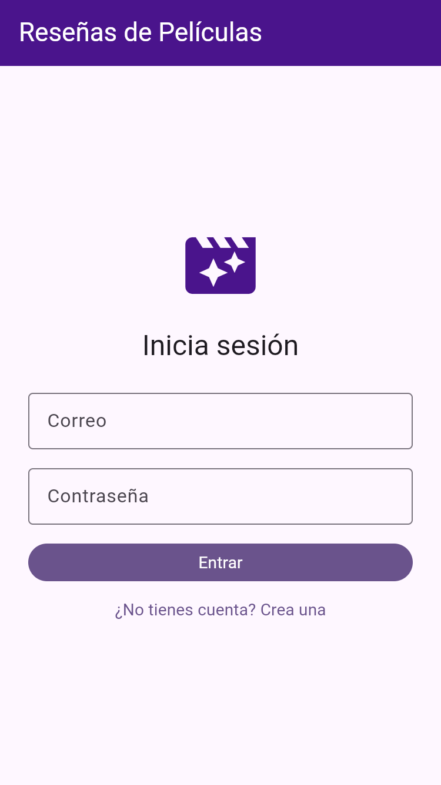
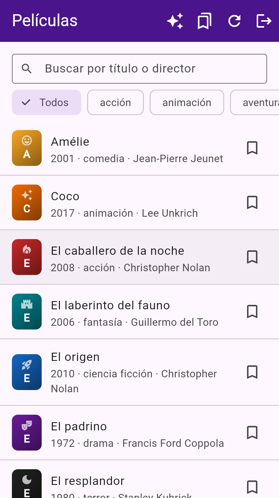
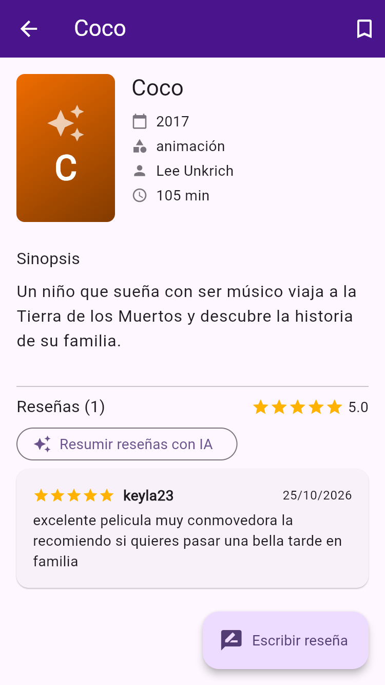
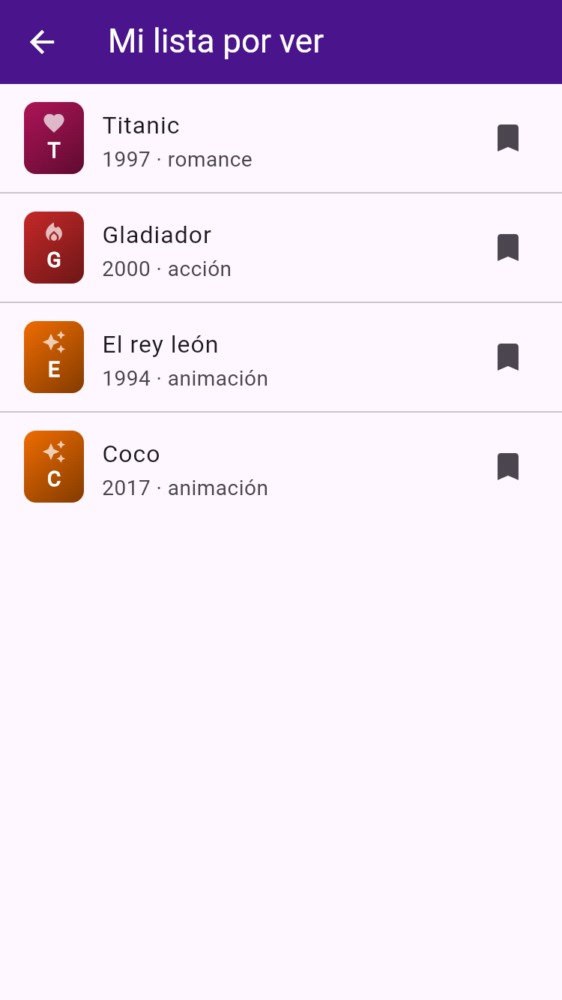
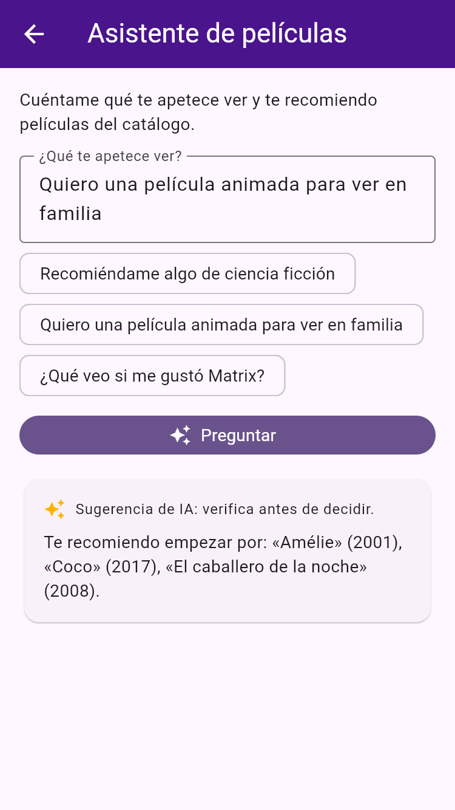
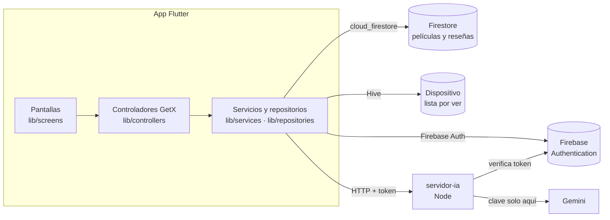

# Reseñas de Películas

App Flutter para explorar un catálogo de películas, **escribir reseñas que ven todos los usuarios en tiempo real**, guardar una lista **«por ver»** en el dispositivo y pedir **recomendaciones y resúmenes a un asistente de IA** a través de un servidor propio.

Proyecto Final del curso *Desarrolla Aplicaciones Móviles Robustas con Flutter e IA* (CEDIA) — Misael Seminario.

[](https://github.com/misaelseminario/resenas-peliculas/actions/workflows/ci.yml)

---

## Qué hace la app

| Funcionalidad | Cómo se usa | Dónde se guarda |
|---|---|---|
| Registro, inicio y cierre de sesión | Pantalla de inicio; la sesión sobrevive al reinicio | Firebase Authentication |
| Catálogo de 27 películas | Lista con búsqueda (título o director) y filtro por género | Firestore (`peliculas`) |
| Reseñas colaborativas | En la ficha de cada película: escribir (1 a 5 ★ y texto), editar y eliminar la propia; las de los demás aparecen solas | Firestore (`peliculas/{id}/resenas/{uid}`) |
| Mi lista por ver | Marcador 🔖 en el catálogo y en la ficha; pantalla propia | Hive, en el dispositivo (una caja por usuario) |
| Asistente de IA | ✨ en el catálogo: recomendaciones solo del catálogo. En la ficha: «Resumir reseñas con IA» | Servidor propio `servidor-ia/` (Gemini o modo reglas) |

### Capturas

| Inicio de sesión | Catálogo | Ficha y reseñas | Mi lista | Asistente |
|---|---|---|---|---|
|  |  |  |  |  |

---

## Instalar y probar el APK (lo más rápido)

1. Descarga `app-release.apk` desde **[Releases](https://github.com/misaelseminario/resenas-peliculas/releases)** (lo genera GitHub Actions al publicar una etiqueta `v…`).
2. Con el emulador Android encendido, arrastra el APK a la ventana del emulador, o:
   ```bash
   adb install -r app-release.apk
   ```
   Si ya había una versión de depuración instalada: `adb uninstall com.misaelseminario.resenas_peliculas` antes.
3. Abre **Reseñas de Películas**, toca «¿No tienes cuenta? Crea una» y regístrate con cualquier correo (mínimo 6 caracteres de contraseña).

**No hace falta encender nada más** para el inicio de sesión, el catálogo, las reseñas ni la lista: Firebase está en la nube. Solo el **asistente de IA** necesita el servidor propio encendido en el mismo computador del emulador (ver abajo).

---

## Ejecutar desde el código

### Requisitos

- Flutter **3.47.5** (canal stable) con Dart 3.13 — `flutter --version`
- Android Studio con un emulador (Android 7 / API 24 o superior), o Chrome/Edge para la versión web
- Node.js **18 o superior**, solo para el servidor de IA — `node --version`

### 1. Descargar y preparar

```bash
git clone https://github.com/misaelseminario/resenas-peliculas.git
cd resenas-peliculas
flutter pub get
```

La app ya apunta al proyecto de Firebase `resenas-peliculas` (archivo `lib/firebase_options.dart`). **No necesitas crear tu propio Firebase** para probarla.

### 2. Encender el servidor del asistente de IA (terminal aparte)

```bash
cd servidor-ia
node servidor.js
```

- Sin más configuración arranca en **modo REGLAS**: responde sin internet ni clave (recomendaciones por género y resúmenes por promedio).
- Para usar **Gemini**: crea una clave gratuita en <https://aistudio.google.com/apikey> y defínela **solo en la terminal** antes de encender:
  ```bash
  # Linux / Mac
  export GEMINI_API_KEY="tu-clave"
  # Windows (PowerShell)
  $env:GEMINI_API_KEY="tu-clave"
  ```
  También puedes copiar `servidor-ia/.env.example` como `servidor-ia/.env` y completarla (ese archivo está en `.gitignore`).
- Debe mostrar: `Servidor del asistente (modo …) escuchando en http://localhost:3000`.

### 3. Ejecutar la app

```bash
flutter run                 # emulador Android
flutter run -d chrome       # o -d edge: versión web
```

### Direcciones por entorno

| Entorno | Servidor de IA que usa la app |
|---|---|
| Emulador Android (y el APK del Release) | `http://10.0.2.2:3000` (el `localhost` del computador visto desde el emulador) |
| Web (Chrome / Edge) | `http://localhost:3000` |
| Teléfono real u otra dirección | `flutter run --dart-define=ASISTENTE_URL=http://IP-DE-TU-PC:3000` |

Firebase (login, catálogo y reseñas) no depende del entorno: siempre usa HTTPS a los servidores de Google.

### 4. Pruebas

```bash
flutter analyze
flutter test
```

Las pruebas usan servicios falsos (`test/fakes/`): no necesitan Firebase, internet ni el servidor de IA. La CI de GitHub las ejecuta en cada subida.

### (Opcional) Usar tu propio proyecto de Firebase

Solo si quieres tu propia base de datos:

1. Crea un proyecto en <https://console.firebase.google.com> con **Authentication → Correo/contraseña** y **Firestore** (modo producción).
2. `dart pub global activate flutterfire_cli` y `flutterfire configure --platforms=android,web`.
3. Registra una cuenta en la app y carga el catálogo (`datos/peliculas.json`):
   ```bash
   firebase deploy --only firestore:rules --config herramientas/carga/firebase.json   # reglas temporales
   node herramientas/cargar_peliculas.mjs                                            # pide tu correo y contraseña
   firebase deploy --only firestore:rules                                            # reglas definitivas (¡no lo omitas!)
   ```

---

## Arquitectura



- **Pantallas** (`lib/screens`, `lib/widgets`): solo dibujan y leen controladores. Ninguna llama a Firebase, Hive ni HTTP.
- **Controladores GetX** (`lib/controllers`): estado compartido — sesión (`AuthController`), catálogo y filtros (`CatalogoController`), reseñas de una película en tiempo real (`ResenasController`), lista por ver (`ListaPorVerController`) y asistente (`AsistenteController`).
- **Servicios y repositorios** (`lib/services`, `lib/repositories`): cada uno es una **interfaz** con su implementación real (`FirebaseAuthService`, `FirestorePeliculasRepository`, `FirestoreResenasRepository`, `HiveListaPorVerRepository`, `HttpAsistenteService`). Traducen los errores técnicos a mensajes en español.

### Manejo de errores

Cada pantalla con datos tiene estados de **cargando**, **vacío** y **error** distintos (con «Reintentar» o una acción para salir). Mensajes según quién falla:

| Situación | Mensaje |
|---|---|
| Sin internet al cargar el catálogo | «No hay conexión con el servidor. Revisa tu internet e inténtalo de nuevo.» |
| Reseñas sin conexión | Aviso «Sin conexión: las reseñas pueden no estar al día.» |
| Firestore rechaza una escritura | «No tienes permiso para hacer esto. Inicia sesión de nuevo.» |
| Servidor de IA apagado | «No se pudo conectar con el asistente. ¿Está encendido el servidor (servidor-ia)?» |
| IA: **401** token inválido | «Tu sesión no es válida. Inicia sesión de nuevo.» |
| IA: **400 / 422** petición inválida | El motivo que devuelve el servidor (p. ej. «Escribe una pregunta.») |
| IA: **429** cuota agotada | «Se alcanzó el límite gratuito de consultas a la IA. Inténtalo más tarde.» |
| IA: **5xx** | «El asistente tuvo un problema. Inténtalo de nuevo.» (o el detalle del proveedor) |

Para comprobarlo: desconecta el Wi-Fi y toca recargar en el catálogo, o apaga `servidor-ia` y pregunta al asistente.

### Decisiones técnicas

**Firebase en lugar de un backend propio con Docker.** Elegí Firebase Auth + Firestore porque quien evalúa puede instalar el APK y usar todo sin levantar servidores, y porque Firestore da **tiempo real** para las reseñas (lo que hace visible la colaboración). Descarté reutilizar el backend de gastos del curso porque solo tiene usuarios y gastos, y obligaría a correr Docker para probar la app.

**Catálogo propio en Firestore en lugar de TMDB u OMDb.** Esas APIs exigen una clave para la lista principal; sin la mía, el APK no mostraría nada. Un conjunto propio de 27 películas (`datos/peliculas.json`, cargado con un script) funciona en cualquier emulador. Los pósteres son ilustraciones por género generadas en la app: no dependen de imágenes de terceros ni de sus licencias.

**Interfaces y servicios falsos para las pruebas.** Probé `fake_cloud_firestore` y `firebase_auth_mocks`, pero no son compatibles con las versiones actuales de Firebase (no compilan). Definí cada servicio como interfaz y escribí implementaciones falsas en `test/fakes/`; así las pruebas corren sin red y el controlador no depende de Firebase.

**Una reseña por persona y película** (documento con el `uid` como id). Simplifica las reglas de seguridad («solo el dueño escribe su documento») y evita duplicados.

---

## Seguridad

- **Clave de IA:** vive **solo** en el servidor `servidor-ia/`, en la variable de entorno `GEMINI_API_KEY`. La app no conoce ninguna clave. `.env` está en `.gitignore`; el repositorio solo tiene `servidor-ia/.env.example` sin valores.
- **Token de sesión:** lo guarda y renueva el SDK oficial de Firebase Auth (en Android, en el almacenamiento privado de la app, al que otras apps no acceden; en la web, en IndexedDB del navegador). El token dura una hora y se renueva solo; la app nunca lo imprime ni lo guarda por su cuenta. Solo viaja en la cabecera `Authorization` hacia el servidor de IA, que lo **verifica con Firebase** antes de responder (sin token válido → 401).
- **Autorización real:** `firestore.rules` se ejecuta en los servidores de Google. Catálogo: solo lectura con sesión. Reseñas: cualquiera con sesión lee; solo el autor crea, edita o borra la suya, y el servidor valida estrellas (1–5), largo del texto (3–500), autor y fecha.
- **Datos mínimos a la IA:** título, año, género, estrellas y texto de las reseñas. Nunca correos, nombres ni el token en el cuerpo. El servidor registra solo el tamaño y los nombres de los campos.
- **`lib/firebase_options.dart` y `android/app/google-services.json` no son secretos:** identifican el proyecto de Firebase, pero el acceso lo controlan las reglas. Así lo indica la documentación de Firebase.
- **Android:** el tráfico HTTP sin cifrar solo se permite hacia `10.0.2.2` y `localhost` (servidor local de IA); todo lo demás exige HTTPS.

---

## Créditos y licencias

- **Datos del catálogo:** títulos, años, directores, géneros y duraciones de películas de conocimiento público; las sinopsis son textos breves propios. Los títulos pertenecen a sus respectivos dueños.
- **Paquetes** (versiones exactas en `pubspec.lock`):
  - `firebase_core`, `firebase_auth`, `cloud_firestore` — BSD-3-Clause (Google)
  - `get` — MIT
  - `hive`, `hive_flutter` — Apache-2.0
  - `dio` — MIT
  - Flutter SDK — BSD-3-Clause
- **IA:** Google Gemini a través de la API de Google AI Studio (plan gratuito). En el plan gratuito, Google puede usar las consultas para mejorar sus productos; por eso se envían solo datos mínimos.
- Desarrollado con ayuda de un agente de código (Claude Code); todo el código fue revisado y verificado con `flutter analyze` y `flutter test`.
